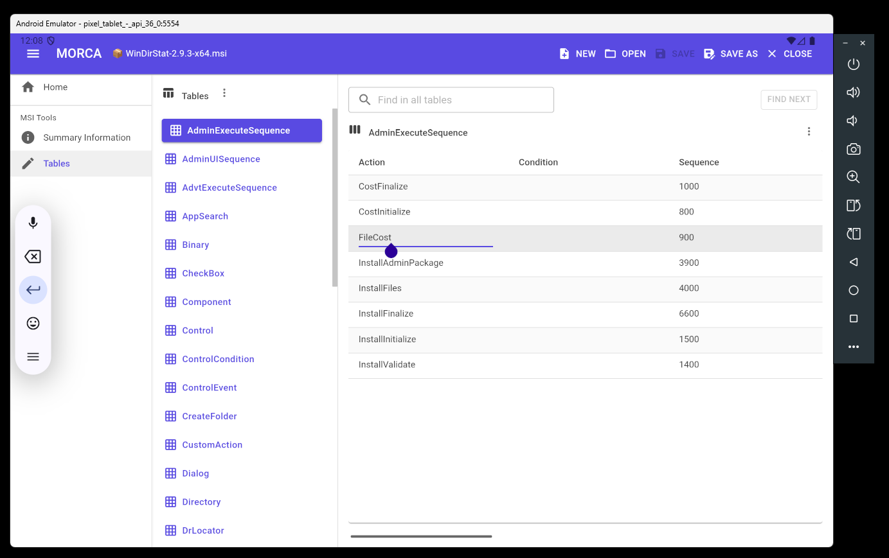

# MORCA

**A multiplatform Windows Installer database (.MSI) editor.** MORCA is an Orca-style editor for the MSI databases that WiX and other tools produce. It runs on Windows, Android, iOS and Mac Catalyst from one .NET MAUI Blazor Hybrid codebase, and it reads and writes MSI files itself, so it needs no `msi.dll` and no Windows SDK.



## Capabilities

### Working with files
- **New, Open, Save, Save As and Close** for `.msi` databases. A new database starts empty and is untitled until you save it.
- **Safe saves.** MORCA writes a temporary file next to the destination and moves it into place, so a failed save never leaves a half-written MSI.
- **Change tracking.** The title bar shows whether the database has unsaved changes. If you edit a cell and then put the original value back, MORCA works out in the background that nothing has changed and clears the marker. While that check runs the marker shows `?` (maybe changed), and a further edit cancels the check in progress and starts a new one.

### Summary Information
Edit the package's summary stream: Title, Subject, Author, Keywords, Comments, Platform, Languages, Package Code, Schema, Security, and the Compressed, Administrative Image and UAC Compliant flags.

### Tables
- **Table list.** Every table in the database is listed, with `_Validation` shown at the top. Choose one to see its rows.
- **Find across all tables.** Type text, then choose Find Next. MORCA looks through every table, highlights the matching cell, scrolls to it, and moves on to the next table when it runs out of matches. It wraps around to where the search started and tells you when there are no more matches.
- **Add Table.** Add any of the 111 standard Windows Installer tables (`ActionText`, `Component`, `Control`, `Feature`, `File` and so on) with the standard column definitions.
- **Add Custom Table.** Define your own table: name, columns, types, lengths, nullability, and which leading columns form the primary key.
- **Adjust Schema.** Rename, add, remove and retype the columns of an existing table. Existing data is carried over.
- **Drop Table.**
- **Export Tables / Import Tables.** Write tables to `.idt` text files and read them back, the same interchange format used by Orca and the Windows Installer SDK tools.

### The data grid
- **Edit in place.** Click a cell and type. The value is checked against the column (required values, whole numbers, the 16-bit range of Integer columns, maximum text length) and saved to the database straight away.
- **Primary keys.** Changing a key value replaces the row correctly, and rows are shown sorted by their primary key.
- **Sorting and column sizing.** Click a column header to sort, and drag header edges to resize columns. The header stays in view while you scroll.
- **Binary cells.** Import a file into a Binary cell, export it to a file, or empty it. Binary data can also be chosen when adding a row.
- **Row selection.** Click selects a row, Ctrl+click adds or removes one, and Shift+click selects a range.

### The cell menu
Right-click a cell (on a touch screen, use the ⋮ button next to the table name) for a menu modelled on Orca's:

| Item | What it does |
| --- | --- |
| Cut / Copy / Paste Cell | Works with the system clipboard. |
| Paste New GUID | Puts a new `{GUID}` in a text cell. |
| Import Text File... | Loads the contents of a text file into a cell. |
| Cut / Copy / Paste Row(s) | Works on all selected rows, including their Binary data. |
| Add Row | Opens a form for a new row. Works on an empty table too. |
| Drop Row | Deletes the selected rows. |
| View in Decimal / Hexadecimal | Shows a number column as `0x1A` or as a plain number. You can type hexadecimal with a `0x` prefix. |

*Errors...* appears in the menu but is not available yet, because MORCA does not have a validation engine.

### Multiplatform
- Windows, Android, iOS and Mac Catalyst targets from one codebase.
- Input adapts to the device: right-click on a mouse, a menu button on touch screens.

## How MORCA reads and writes MSI files

MORCA uses [IsWiX.WindowsInstaller](https://github.com/iswix-llc/IsWiX.WindowsInstaller), a managed library that reads and writes the MSI file format directly. That is why the same editor runs on platforms that have no Windows Installer service.

## Building

MORCA is built with .NET 10 and the .NET MAUI workload.

```
dotnet workload install maui
dotnet build Application/MORCA/MORCA.csproj
```

`publish.bat` and the GitHub workflow in `.github/workflows/build.yml` produce the signed Windows installer, which is itself an MSI built from `Installer/MORCA`.

## License

MIT. See [LICENSE](LICENSE).
